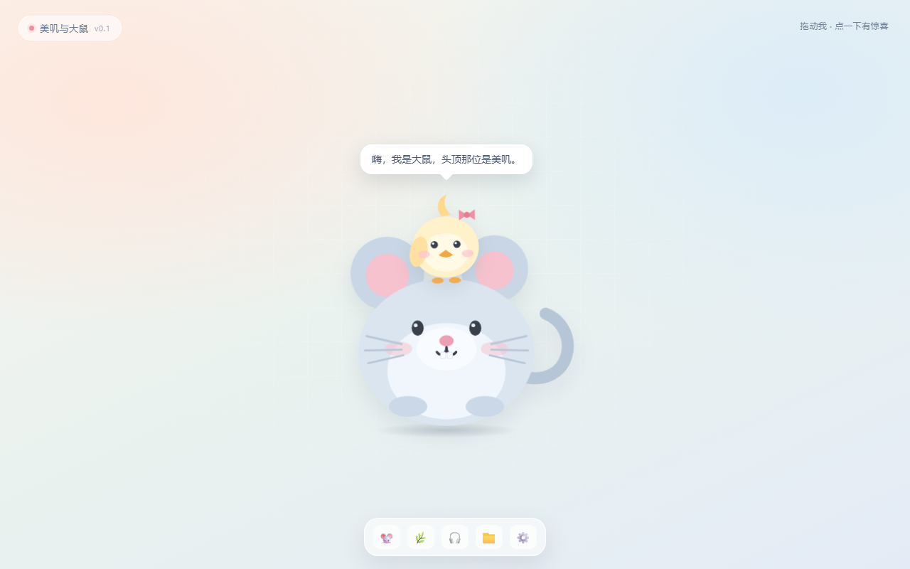

# 美叽与大鼠 · 桌面宠物

一个用来**边做边学前端**的小项目：让「美叽」和「大鼠」住进一个可以拖动、会眨眼、会说话的页面里。
现在是网页原型（v0.1），下一步会装进 Electron，变成真正待在 Windows 桌面上的宠物。

> 角色形象目前是 SVG 画的占位版，之后可以替换成你自己的立绘或序列帧。



## 现在能做什么

- 按住拖动，位置会被限制在窗口内
- 单击 / 按回车：跳一下、飘心心、随机说一句话
- 自动眨眼、呼吸、美叽轻轻摇晃
- 戳满 15 次有小彩蛋
- `index.html?transparent=1` 打开透明模式（给以后的 Electron 用）

## 怎么运行

**最简单**：双击 `index.html`，用默认浏览器打开。

**更接近真实开发**（推荐，后面会用到）：在本文件夹打开终端，运行

```powershell
python -m http.server 5173
```

然后浏览器访问 <http://localhost:5173>。

## 文件地图

| 文件 | 作用 | 类比 |
| --- | --- | --- |
| `index.html` | 页面结构：有哪些元素、谁套在谁里面 | 房子的骨架 |
| `style.css` | 外观和动画：颜色、大小、位置、呼吸和眨眼 | 装修和动作指导 |
| `pet.js` | 行为：拖动、点击、说话、随机数 | 大脑和神经 |
| `preview.png` | 页面截图 | 照片 |
| `assets/` | 以后放角色图片、音效 | 道具间 |

## 学习路线

- [x] **阶段 0 · 网页原型**：HTML / CSS / JS 三件套，做出能玩的第一版
- [ ] **阶段 1 · Git 与 GitHub**：版本管理、提交、远程仓库、README
- [ ] **阶段 2 · Electron**：把网页装进透明、置顶、无边框的桌面窗口
- [ ] **阶段 3 · 打包发布**：生成 `.exe`、托盘图标、开机自启
- [ ] **阶段 4 · 更像宠物**：真实素材、状态机（走路 / 睡觉 / 饿）、存档

## 这一版用到的概念

- **DOM**：JS 用 `document.getElementById` 找到页面元素，再改它的样式和文字
- **绝对定位**：`position: fixed` + `left/top` 让宠物可以停在窗口任意位置
- **transform 动画**：`scale`（呼吸）、`translateY`（跳）、`scaleY`（眨眼）
- **指针事件**：`pointerdown / pointermove / pointerup` 一套组合实现拖动
- **事件与状态**：用 `drag.moved` 区分「拖动」和「点击」
- **定时器**：`setTimeout` 安排眨眼和气泡自动消失

## 小练习（想动手时试试）

1. 在 `pet.js` 的 `LINES` 里加一句你自己的台词。
2. 把 `style.css` 里 `.rat` 的 `width` 改成 `420px`，看看页面哪里需要跟着调。
3. 给 `poke()` 加一个「连续点击 5 次后跳得更高」的分支。
